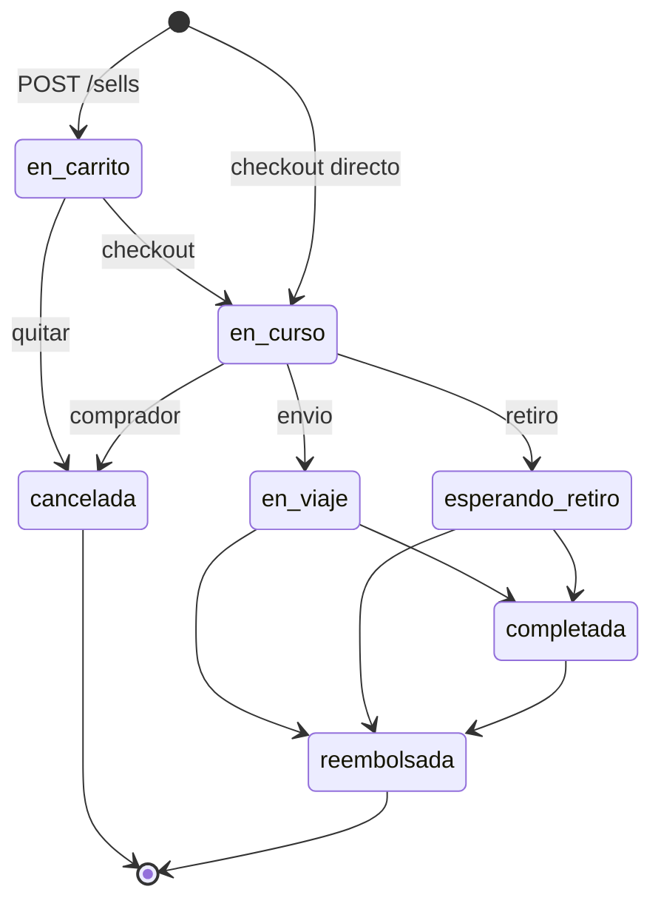

# ADR 0005: Máquina de estados de compras (`sells`)

- Status: aceptada
- Date: 2026-11-01

## Contexto

Cada línea de carrito/orden es una fila `sells`. Hay que distinguir “aún no pagué”, “pagué y se despacha”, “ya cerró”, sin mezclar envío y retiro, y sin un motor de pagos real.

## Decision

Estados: `en_carrito`, `en_curso`, `en_viaje`, `esperando_retiro`, `completada`, `cancelada`, `reembolsada`.

El pago es mock. Checkout (`POST /sells/checkout`) pasa a `en_curso`, descuenta stock y acredita `subtotal` al vendedor. Stock 0 → publicación pausada.

Transiciones permitidas:

- Comprador: `en_carrito` → `cancelada` (sin tocar stock/saldo); `en_curso` → `cancelada` (revierte stock y crédito).
- Vendedor/admin: `en_curso` → `en_viaje` **o** `esperando_retiro` (según fulfillment, no se cruza); `en_viaje` | `esperando_retiro` → `completada` | `reembolsada`; `completada` → `reembolsada`.
- `cancelada` y `reembolsada` son terminales.

ETA mock: al pasar a `en_viaje`, `eta_at = now + 48h`. Solo envío. El vendedor no la edita.

Listados `/compras` y `/ventas` excluyen `en_carrito`. `GET /sells/{id}` 404 si está en carrito.

Métricas de dashboard (ventas realizadas, monto, ganancia, series) cuentan solo `completada`. `updated_at` es el instante del último cambio de estado (corte de período). Órdenes abiertas: snapshot `en_curso` | `en_viaje` | `esperando_retiro`.

Contrato: `docs/compra-carrito.md`, seguimiento `docs/seguimiento-chat.md`.

## Consecuencias

No hay estado “preparando” aparte de `en_curso`. Un envío no puede pasar a retiro a mitad de camino. Reembolsar después de completada es explícito y revierte stock/crédito. El gráfico de ganancia ignora carrito, abiertas, canceladas y reembolsos.
