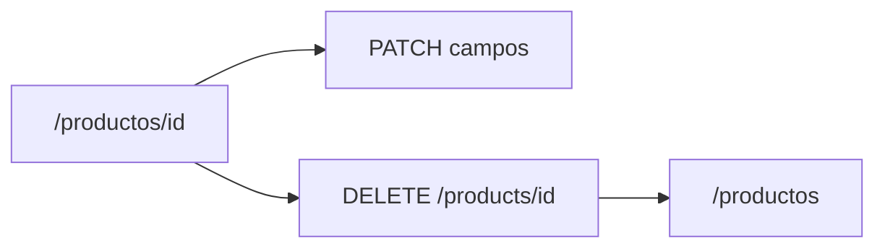

# Editar visible y eliminar publicación

## Qué faltó

El formulario **Editar publicación** ya está en `frontend/app/product-admin.tsx`, pero solo se renderiza si `canManage` es verdadero (el `seller_email` coincide con tu sesión, o sos admin de esa tienda). En la verificación se abrió p.ej. `/productos/26`, publicado por un usuario de tests (`ana.prod…`), con la sesión de `ana.reload@…` como comprador: no hay Pausar ni editar. Además el formulario vive en una **segunda card** debajo; en layout de dos columnas es fácil no verlo.

**Eliminar no estaba en el plan anterior** (`docs/ficha-admin-producto.md`): no hay `DELETE` ni botón.

## Qué cambia

### Backend

En `backend/app/routers/products.py`:

- `GET /products/{id}` incluye `can_manage: bool` (misma regla que `_can_pause`) para no adivinar en el cliente.
- `DELETE /products/{id}`: mismo permiso. Si no se ve → `404`; si se ve y no se administra → `403`. Borrar respuestas, preguntas, fila e imagen. `204` sin body.
- Tests en `backend/tests/test_products.py`: vendedor borra y el GET da 404; comprador `403` y el producto sigue; pausada oculta al comprador `404`.

### Frontend

En la ficha de `product-admin.tsx`, **una sola card** (ancho completo):

- Datos editables siempre a la vista si `can_manage` (nombre, cantidad, precio, categoría, subcategoría, imagen), no una card extra.
- Acciones arriba: Pausar/Reanudar, **Eliminar** (`text-destructive` / secondary). Confirmar en la UI (paso corto, sin `window.confirm`). Al borrar, ir a `/productos`.
- Si no administrás: ficha de solo lectura + preguntar, igual que ahora.
- Cliente `deleteProduct` en `frontend/lib/api.ts`.
