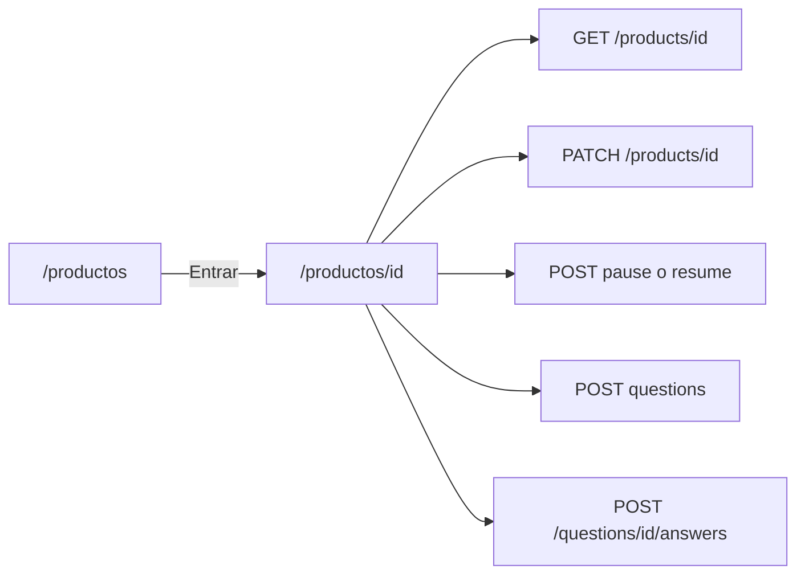

# Ficha de administración de producto

Cada publicación se abre en `/productos/[id]` para administrarla: ver y cambiar estado, editar datos de la publicación e imagen, y ver/responder preguntas. El listado deja de incrustar la ficha.

## Flujo

- Quien publica o es admin de la tienda: edita campos, cambia estado, elimina, responde.
- El resto (comprador que puede verla): ve ficha, estado e historial, y puede preguntar. Sin formularios de edición ni pausa.

## Backend

Contrato nuevo en `backend/app/routers/products.py`, mismo permiso que pausa (`_can_pause`: vendedor o admin de la tienda):

- `PATCH /products/{product_id}` multipart, igual que el alta: `name`, `quantity`, `price`, `category`, `subcategory`, `image` opcional.
- Si no viene imagen, se conservan `image_path` y el archivo.
- Si viene imagen, mismas reglas (PNG/JPEG/GIF, validación existente); reemplazar archivo.
- Validación inválida: `422` `{ "detail": "Los datos enviados no son válidos" }`.
- Sin permiso: `403` genérico. Producto inexistente o pausado no visible: `404` genérico (igual que el GET).
- No se cambia `store_id` ni vendedor.

Tests en `backend/tests/test_products.py`:

- Happy: el vendedor actualiza nombre/precio/cantidad y, en otro caso, la imagen.
- Esquina: no miembro `403`; datos inválidos `422` y no persiste; comprador no edita; pausada sigue oculta al comprador.

## Frontend

- Listado `frontend/app/product-list.tsx`: cada ítem es un `Link` a `/productos/{id}` (título e imagen). Sacar `selectedId` y el embed de la ficha. Badge de estado en el listado; pausar queda en la ficha.
- Nueva ruta `frontend/app/productos/[id]/page.tsx` + `loading.tsx`.
- Reutilizar/adaptar la ficha: datos, imagen, badge Activa/Pausada, Pausar/Reanudar, formulario de edición (mismos campos que el alta, imagen opcional), preguntas con prioridad a las sin respuesta, preguntar/responder según rol.
- Loading / empty / error con `detail`. Volver a `/productos`.
- Nav: marcar Productos activo si el path empieza con `/productos`.
- Cliente `updateProduct` en `frontend/lib/api.ts`. Estilos según `STYLE.md`.

## Fuera de alcance

- Órdenes, KPIs, catálogo público sin login.
- Filtros extra del listado (salvo lo que ya tenga `GET /products`).
