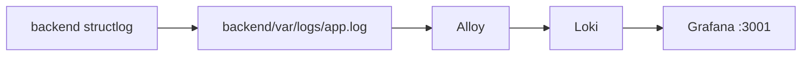

# Logs a archivo + Alloy / Loki / Grafana

El backend escribe logs JSON en `backend/var/logs/app.log`. Grafana Alloy los envía a Loki. Grafana (puerto **3001**) los muestra. Los `.log` no se versionan.

## Escritura

- structlog JSON a stdout y a archivo rotado (`LOG_FILE`, default `var/logs/app.log`).
- Mismos campos: request_id, method, path, status, latency, user_id. Sin secretos.
- `/health` no genera access log.
- Pytest usa un directorio de test para no tocar el archivo de compose.

## Compose

- `loki`: filesystem, volumen `loki_data`.
- `alloy`: lee `/var/log/mlsre/app.log` (bind `./backend/var/logs`), labels `job=backend`, `service=mlsre`.
- `grafana`: `localhost:3001`, volumen `grafana_data`, datasource Loki provisionado.

## Uso

`docker compose up --build`. Grafana: `http://localhost:3001`. Explore → Loki: `{job="backend"}`.
