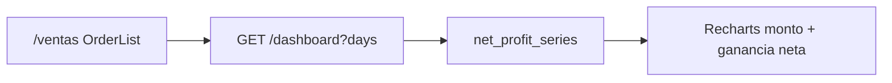

# Ganancia neta a través del tiempo

Gráfico en `/ventas` y en `/dashboard` (solo vendedor). `/compras` no lo muestra. En el dashboard usa el mismo selector 7/30/90 de la página.

## Qué cuenta

Igual que el KPI `net_profit_total` del dashboard:

- Solo ventas `completada`.
- `sum(products.net_profit * sells.quantity)` con el `net_profit` actual del producto.
- Día UTC según `Sell.updated_at` (cuando pasó a completada).
- Alcance: vendedor ve lo suyo; admin de tienda, todas las de esas tiendas.

## API

`GET /dashboard?days=7|30|90` agrega `net_profit_series`: un punto por cada día UTC del rango (`from` inclusive hasta hoy), `amount` (subtotal), `net_profit` del día y `cumulative` corrido. Días sin ventas: `0.00`.

## UI

Selector 7 / 30 / 90. Área gris = monto vendido; línea verde = ganancia neta. Tooltip con `$`. El acumulado queda en la API, no en el gráfico, para no mezclar tres series.
