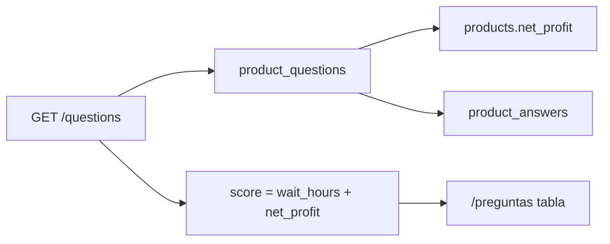

# Preguntas del vendedor por criticidad

Página `/preguntas` (solo vendedores). El comprador no entra.

## Qué se ve

Tabla de preguntas a las publicaciones del alcance del vendedor:

- Producto (enlace a `/productos/[id]`)
- Pregunta
- Desde (`created_at`)
- Espera (horas sin respuesta)
- Ganancia neta del producto
- Criticidad (score)
- Estado: Pendiente / Respondida

Filtro: Pendientes (default) / Respondidas / Todas. Paginación, máximo 100.

## Score

No se persiste. Se calcula en cada `GET`.

- Pendiente: `wait_hours = (now UTC − created_at) / 3600`
- Respondida: `wait_hours = 0`
- `score = wait_hours + net_profit`

`net_profit` es el de la publicación (por unidad). Orden default: score descendente.

## Alcance

Igual que `GET /dashboard`:

- vendedor: `products.seller_user_id = yo`
- admin de una tienda: preguntas de todos los productos de esas tiendas

## API

`GET /questions?status=pending|answered|all&sort=score|wait|net_profit|created_at|name&order=desc|asc&page=&page_size=`

JWT. 403 si no hay membresía. 422 si el query no cierra.

Ítem: `id`, `product_id`, `product_name`, `text`, `answer`, `created_at`, `wait_hours`, `net_profit`, `score`.

Responder sigue en `POST /questions/{id}/answers` desde la ficha.

