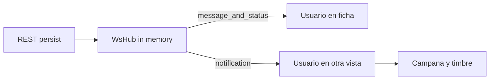

# Seguimiento de órdenes, chat y notificaciones

Extiende el dominio de `sells` ([compra-carrito.md](compra-carrito.md)): una orden es una fila ya pagada (`en_curso` en adelante). El carrito no entra en esta vista.

## Alcance

- Comprador: listado `/compras` y ficha `/compras/[id]`.
- Vendedor: listado `/ventas` y ficha `/ventas/[id]`. Misma ficha, distinto menú. Las ventas no viven en `/tienda`.
- En la ficha: estado, producto, montos, cumplimiento. ETA solo si `fulfillment=envio` y estado `en_viaje` (o `completada` con envío). No hay ETA en retiro, ni en cancelada/reembolsada.
- ETA mock: al pasar a `en_viaje` se guarda `eta_at = now + 48h`. El vendedor no lo edita.
- Chat de texto plano entre comprador y vendedor/admin de la tienda, solo en órdenes que no estén `en_carrito`.
- Si el usuario está en `/compras/[id]` o `/ventas/[id]` de esa orden: mensaje y estado llegan por WebSocket y se pintan al toque, sin campana ni sonido.
- Si no está en esa ficha: se crea notificación, sube el badge de la campana y suena un timbre breve.
- Eventos de notificación: mensaje nuevo, cambio de estado, pregunta o respuesta en una publicación, y venta confirmada.

## Backend

Migración `006_order_tracking`:

- `sells.eta_at` nullable timestamptz. Se setea al transicionar a `en_viaje`.
- `sell_messages`: `id`, `sell_id`, `sender_user_id`, `body` (máx. 1000), `created_at`.
- `notifications`: `id`, `user_id`, `sell_id` (opcional), `product_id` (opcional), `kind` (`mensaje` | `estado` | `pregunta` | `respuesta` | `venta`), `title`, `body` (textos genéricos, sin emails), `read_at`, `created_at`.

Contrato REST (JWT `Authorization`, error `{ "detail": "..." }` en español):

- `GET /sells/{id}` — comprador, vendedor o admin de la tienda; 404 si no corresponde o si está `en_carrito`. Incluye `eta_at`, `updated_at`, `can_manage`.
- `GET /sells/{id}/messages` — paginado, máx. 100.
- `POST /sells/{id}/messages` `{ "body": "..." }` — persiste, notifica al otro lado, emite por WS. Rate limit 20/min.
- `GET /notifications` — del usuario, paginado; `unread=true` opcional. Incluye `as_seller` para el enlace.
- `POST /notifications/{id}/read` y `POST /notifications/read-all`.

WebSocket `WS /ws`:

- Primer frame `{ "type": "auth", "token": "<access>" }`. Si falla, se cierra. No se loguea el token.
- Luego `{ "type": "watch", "sell_id": n }` / `unwatch` (solo si el usuario es parte de la orden), o `{ "type": "watch", "product_id": n }` en la ficha de publicación.
- Hub en memoria (un proceso). Eventos `message`, `status`, `question`, `answer`, `notification`.
- Origin debe coincidir con CORS. Si el destinatario está en `watch` de esa orden o publicación, no se crea notificación (salvo una venta nueva, que siempre campana).

## Frontend

- Cliente WS con el access token en memoria (`NEXT_PUBLIC_API_URL` → `ws://localhost:8000/ws`). Reconnect y re-auth.
- Provider en el layout autenticado. Campana en el header: badge, lista, click marca leída y navega a `/compras/[id]` o `/ventas/[id]`.
- Timbre con `AudioContext` (beep corto, sin archivo). Se habilita en el primer click o tecla. Solo con evento `notification`.
- Nav: Compras para todos; Ventas solo seller.

## Fuera de alcance

- ETA real, mapas o courier.
- Adjuntos en el chat.
- Redis o múltiples réplicas de backend.
- Push del sistema operativo o email.
